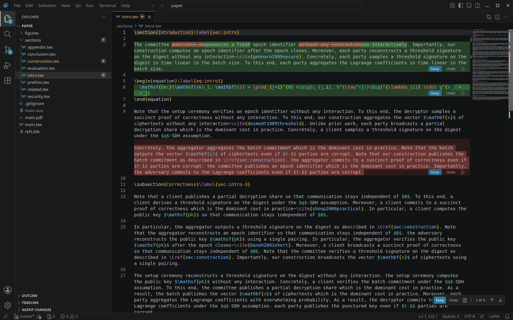

# Editor

*Placeholder name.*

Editor is a VSCodium-based editor that lets you review what a coding agent changed, inline, the way Cursor does, but with **any** CLI agent: Claude Code, Codex, tact, or anything else that writes files. It contains no AI and calls no models: you run your own agent, in a terminal or (tact) from a chat panel. It watches your files, and whatever changed on disk since you last accepted it shows up in the editor as a pending change. Deleted text is shown as real red lines, rewritten words are highlighted, and every change has its own **Keep** / **Undo**. It's built mainly for writing LaTeX papers with an agent, and works for code too.



## Quickstart

### macOS (Apple Silicon or Intel)

```bash
xcode-select --install                    # once: Xcode command line tools
brew install node@24 jq                   # once: Node 24 and jq
export PATH="$(brew --prefix node@24)/bin:$PATH"
git clone <this repo> editor && cd editor
fork/scripts/build-macos.sh --install     # ~20-40 min the first time; ~15 GB of disk
open /Applications/Editor.app
```

The script checks the prerequisites first and tells you exactly what's missing. It builds an ad-hoc signed `Editor.app`; no Apple developer account is needed. To rebuild after `git pull`, run the same command. The details and fixes for the usual problems (Node version, out of memory, "Editor is damaged") are in **[docs/build-macos.md](docs/build-macos.md)**.

To get the `editor` shell command, open the command palette in Editor (**Cmd+Shift+P**) and run **Shell Command: Install 'editor' command in PATH**.

### Linux (x64)

```bash
sudo apt-get install -y build-essential pkg-config libx11-dev libxkbfile-dev libsecret-1-dev libkrb5-dev jq python3
# Node 24.18 or newer within 24.x (e.g. nvm install 24)
fork/scripts/prepare-vscodium.sh          # clone VSCodium + VS Code, apply patches, npm ci (~5 min)
fork/scripts/build.sh                     # compile and package (~8 min on 8 cores; 16 GB RAM)
~/.cache/editor-fork-build/vscodium/VSCode-linux-x64/bin/editor
```

## Try it: Keep/Undo in two minutes, no agent needed

`scripts/demo-agent.sh` is a fake agent. It edits a small LaTeX paper (a copy of [`examples/paper/`](examples/paper/)) the way a CLI agent would, writing straight to disk.

```bash
scripts/demo-agent.sh setup            # copies examples/paper to /tmp/editor-demo/paper
editor /tmp/editor-demo/paper          # or: open -a Editor /tmp/editor-demo/paper  (File > Open Folder... works too)
scripts/demo-agent.sh run              # press Enter once the folder is open
```

Over about 6 seconds the fake agent rewords a sentence in `sections/intro.tex`, deletes a line from the abstract, adds a paragraph, changes a number in the results, and creates `sections/related.tex` (plus its `\input` line in `main.tex`). Each change shows up inline with **Keep** / **Undo**:

- **Ctrl/Cmd+Y** keeps the change at the cursor; **Ctrl/Cmd+N** undoes it.
- The ↑/↓ arrows in the overlay jump between changes.
- **Agent Changes** in the Explorer lists every file, including the new one.

To start over, run `scripts/demo-agent.sh setup` again.

## Use it with Claude Code, Codex, or any CLI agent

1. **Open your project folder** in Editor. Whatever is on disk at that point is the accepted state, so nothing is pending yet.
2. **Run your agent.** You can run it in the integrated terminal (`claude`, `codex`, ...) or anywhere else, such as another terminal or tmux. Editor only watches the files. Alternatively, use the **Agent Terminal** docked to the right of the editor: run **Agent Review: Open Agent Terminal** from the command palette. It starts the command in the `agentReview.agent.command` setting (default `tact`; set it to `claude` or `codex`).
   Or **chat with it** (tact): **Agent Chat: New tact Chat** (or the **+** menu in the chat's title) opens a chat in the secondary side bar, or as an editor tab with **New Chat Editor**. It runs your own `tact` (found on PATH; its ACP adapter ships with the editor) over [ACP](https://agentclientprotocol.com); tact edits files itself, so its edits are reviewed below like any other. The input bar has tact's own pickers, exactly as tact's model catalog has them for the chosen model: model (every model tact offers, until the first message), thinking, Pro reasoning (models that have it) and speed (only the tiers the model really runs; none for models with one). A setting tact fixes once a chat has started is shown locked; changing the model resets anything the new model lacks and says so. They're kept per chat: a reopened chat, also after a restart, is back in its own model and settings. tact runs commands and edits without asking; **Stop** cancels the turn. Not signed in? The chat says so and **Sign in** runs `tact auth login` in a terminal. Several chats can run at once; while one agent is working, a message in another chat waits for it to finish (**Run now** skips the wait; **Stop** or closing that chat's tab drops it). Old chats are in the sessions list and in **Search Chats** (the magnifier in the chat's title; it searches what was said, too), and pick up where they left off, also after a restart; chats from Claude Code and Codex, which the chat ran until Nov 2026, are still there, read-only. Details: [extensions/agent-chat](extensions/agent-chat).
3. **Review the changes** as they appear:
   - **Each change:** **Keep** / **Undo** at its end (or under it when its last line is full), or **Ctrl/Cmd+Y** / **Ctrl/Cmd+N** with the cursor in it. **Ctrl/Cmd+Z** takes a Keep or an Undo back (the change is pending again, exactly as it was, on disk too), and **Ctrl/Cmd+Shift+Z** does it again; that works for a whole file, for the Agent Changes list, and for **Keep Deletion** / **Restore File** as well (in the file's editor, or with the Agent Changes list or the Explorer focused). Deleted text is struck through: deleted lines in their red rows, and deleted words. A few changed words in a long line show as track changes (deleted words struck through in red, in the line), also when the agent deleted or added a paragraph right next to it.
   - **A whole file:** the bar at the bottom center of the editor, which starts with the file's name (Keep / Undo for the whole file; "2 of 3" counts that file's changes, and ↑/↓ move between them and on to the next file).
   - **Everything:** the **Agent Changes** list in the Explorer, with Keep All / Undo All and **Open All Changes** (a multi-file diff). Created and deleted files are reviewed there too. A file the agent deletes while it's open turns, in its tab, into the deletion (its text in red) with **Keep Deletion** / **Restore File** above it.

   **Undo** writes the file right away, so the agent never reads undone text back. The exception is a file you have unsaved edits in: the undo then stays in the editor until you save. Text you type inside an agent's change (on one of its lines, or a new line right at its edge) becomes part of it, and **saving never accepts it**: the whole change stays pending, your typing included, against the accepted text, however often you save, until you press Keep (which keeps the change with your edits) or Undo (which asks first, since it would take your typing out too, also after a window reload or restart). Typing on lines with no change stays yours.
4. **Point the agent at text** by selecting lines and pressing **Ctrl/Cmd+L**. That opens the agent chat if it's closed and puts a reference such as `@paper/main.tex:L20-21` into its input at the cursor, as an inline reference, so one message can point at several places ("in this part @main.tex:L7-8, fold in this argument @main.tex:L13"); then tell the agent what to do with it. With nothing selected it references the whole file (`@paper/main.tex`). The formats are configurable (`agentReview.agent.referenceFormat`, `agentReview.agent.fileReferenceFormat`). Ctrl/Cmd+L never goes to the Agent Terminal, and it wins over other extensions' Ctrl/Cmd+L keybindings in a text editor (LaTeX Workshop's `Cmd+L Cmd+B`-style chords, for example); to give Cmd+L to something else, bind it in your keybindings.json.

Your own edits outside the agent's changes are never shown as agent changes. When you save, they're folded into the accepted state, and the agent's changes around them stay pending; saving never accepts any part of an agent's change. That holds with format on save too (JSON, latexindent, ...): a formatter reflowing your line next to an agent change folds your text in and leaves only the agent's lines pending; it never accepts the agent's change. Unsaved edits that come back after a restart are still yours, not the agent's. Sending a chat message doesn't save your unsaved edits, and if anything but your own save changes a file while you have unsaved edits in it (an agent in the chat or in a terminal, a shell command, another tool), nothing is overwritten: a notice offers **Merge…**, a 3-way merge of the version on disk with yours (the notice moves to the notification center after a few seconds; *Agent Review: Merge Agent's Version with Unsaved Edits* does the same). Until you merge, the change is listed in Agent Changes but not drawn inline, since the editor shows your version, not the one on disk. `git add` accepts what it stages: all of a file's pending changes, or with `git add -p` only the hunks you staged (the others stay pending). A commit accepts every file it changes, whole, as it is on disk, as if you pressed Keep File on each, and that includes the hunks of that file you did not stage or commit: they stop being pending even though `git diff` still shows them. If you commit, review makes no guarantees about the committed files (Guru's decision of Oct 8, 2026, #31). Pending changes in every other file stay pending. The same goes for anything else that moves git's HEAD (checkout, pull, merge, rebase, reset): only the files that differ between the old and the new commit are accepted, including both names of a renamed file and deleted files. `git stash` and `git stash pop` accept nothing: the changes come back with the pop. (Until Oct 8, 2026, any HEAD move accepted every pending change in the workspace; Guru changed that for #12.) LaTeX build files (`.aux`, `.log`, the output PDF, ...), `node_modules`, Claude Code's `.claude/settings.local.json` (its "always allow" answers) and anything in `.gitignore` are never shown. Pending changes survive a restart. If something looks wrong, turn on `agentReview.trace`: the **Agent Review** output channel then logs every change to the accepted state with its reason and how each save was attributed.

## Status

Phase 2 (the fork with the built-in review) is done and runs as a packaged Linux build. The ACP chat panel (Phase 4 A–B, most of D, E) runs tact, the only chat harness since Nov 2026 (Claude Code and Codex were removed; what tact would need to match them is in [docs/acp-design.md](docs/acp-design.md#tact-only)), through our own adapter, with chat history and search, several chats at once, per-model pickers from tact's catalog, and inline Cmd/Ctrl+L references. The macOS build script hasn't been run on a real Mac yet. Signing/notarization, Windows and a proposed API are later work; see [PLAN.md](PLAN.md#6-phases).

## Repository

| Path | What |
|---|---|
| [`packages/engine`](packages/engine) | The review engine: accepted baselines, diffs, attribution of user vs. agent edits, git handling. Editor-independent TypeScript |
| [`extensions/agent-review`](extensions/agent-review) | The built-in extension: file watching, the Agent Changes list, the Agent Terminal, Ctrl/Cmd+L |
| [`packages/acp-client`](packages/acp-client) | Editor-independent ACP client: adapter supervision, session reducer, permission broker, the harness profile (tact). No fs/terminal capabilities |
| [`packages/tact-acp`](packages/tact-acp) | An ACP adapter for tact: runs its terminal UI in a hidden pty and bridges ACP to tact's local web API |
| [`extensions/agent-chat`](extensions/agent-chat) | The built-in chat panel: tact in VS Code's native chat, over `acp-client` |
| [`patches/`](patches) | Core patches on top of VSCodium (inline rendering hooks, hunk toolbar, the `agentReview` contribution) |
| [`fork/`](fork) | Build scripts, branding (`fork/branding.env`), pins, readable copies of the new core files |
| [`docs/`](docs) | [Phase 2 details](docs/phase2.md), [macOS build](docs/build-macos.md), [fork build notes](docs/fork-build.md), [ACP design](docs/acp-design.md) |
| [`PLAN.md`](PLAN.md) | Design and plan |

Development: `npm ci && npm run lint && npm run typecheck && npm test` (engine, ACP client, tact adapter, both extensions; `TACT_REAL_BIN=…` adds the tact adapter's tests on the real tact), and `fork/scripts/test-core.sh` / `fork/scripts/lint-core.sh` for the core patches in a prepared tree.
