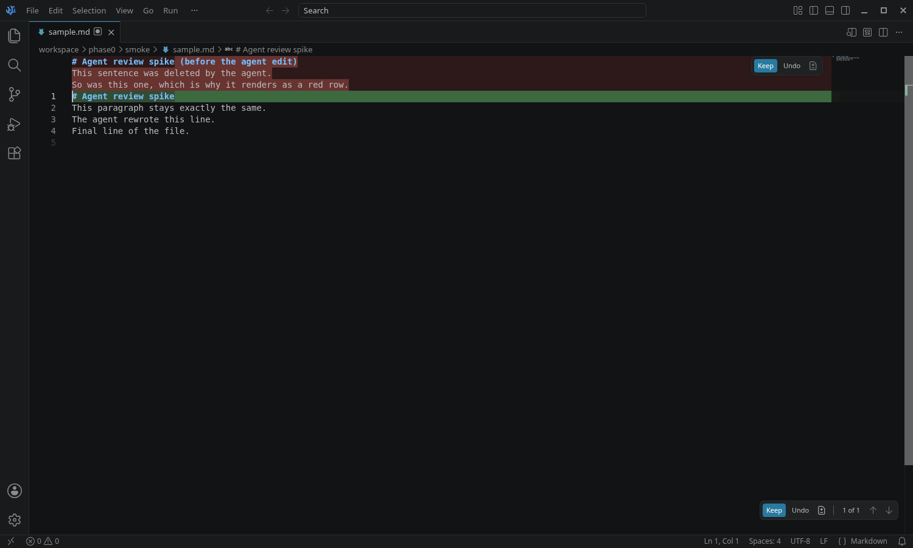

# Phase 0: Inline rendering decision

**Status:** decided, spike passing. **Base read:** VS Code `1.135.0` at `08d4889f` (the commit VSCodium stable pins today), cross-checked against VS Code `main` at `c0cd5735` (`1.142.0`, 2026-10-07). All paths below are in `microsoft/vscode` unless noted.

## TL;DR

Use a **hybrid**: the engine owns the truth, and core reuses VS Code's chat-editing review UI to draw it.

- A new, isolated core contribution, `src/vs/workbench/contrib/agentReview/`, holds one review entry per file with pending changes. An entry's "original" side is the engine's accepted baseline, pushed in from the built-in extension. Its "modified" side is the live text model of the file.
- The contribution registers its entries with `IChatEditingService.registerEditReviewSession(...)`, a hook that is already upstream (inline chat uses it for agent-host disk writes). Once registered, the existing chat-editing UI draws the entries with no rendering code of our own. That covers deleted lines as real rows (view zones drawn with the editor's own line renderer, with syntax colors), character- or word-level highlights, a per-hunk Accept/Reject toolbar, the floating "change *j* of *m*, file *i* of *n*" overlay, keybindings, the accessible diff viewer, and explorer badges.
- We patch only the places where that UI is chat-specific: labels, a gating context key, and one hook for classifying edits. We add our own review list and multi-diff view.

Option (a), exposing view zones to the extension, can't beat this on UI. The extension host has no DOM, so a "view zone API" would have to be declarative, and core would still have to draw the rows. In practice that means rewriting the roughly 950-line `ChatEditingCodeEditorIntegration`, plus extension-host plumbing. Option (b), feeding the engine into a real chat-editing *session*, gives the same pixels as the hybrid. The cost is that state would live in chat objects (`ChatModel`, requests, checkpoints) that don't fit an agent-oblivious, persistent, baseline-driven model.

The spike in `fork/` and `patches/` proves the path. In a real Electron unit-test run on the VSCodium-patched 1.135 tree, an engine-style baseline renders as a view-zone row containing the deleted text, with one Accept/Reject widget. Accept moves the baseline, Reject rewrites the buffer, and an agent's disk write stays pending. All 6 tests pass. Disabling the disk-write classification makes the last test fail, which serves as the negative control.

## What "Cursor-quality" requires, and who provides it

| Requirement | (a) View-zone API for the extension | (b) Feed the engine into a chat-editing *session* | **Hybrid (recommended)**: own review session + reused chat-editing renderer | Void's approach (`editCodeService`) |
|---|---|---|---|---|
| Deleted text as real rows | Yes, but core must render it. The extension host can't create DOM, so the API is declarative (lines + decorations). The existing `editorInsets` proposal gives webview iframes, not editor rows | Yes (`renderLines` view zones) | **Yes**, same code as (b) | Yes (hand-built `view-line` divs) |
| Syntax colors in deleted rows | Only if we rebuild what `renderLines` + `LineSource` already do | Yes (tokenized `LineSource`) | **Yes** | No (plain text) |
| Intra-line highlights | Rebuild | Yes (`innerChanges`; char-level, word-level with `extendToSubwords`) | **Yes** | No (whole-line green and red) |
| Per-hunk Accept/Reject | Rebuild (overlay widget + actions) | Yes (`DiffHunkWidget`, ⌘Y / ⌘N) | **Yes** (relabel Keep/Undo → Accept/Reject) | Yes (`AcceptRejectInlineWidget`) |
| Navigation and file overlay | Rebuild | Yes (`ChatEditingOverlayController`) | **Yes** (overlay shows for `isGlobalEditingSession`) | Partial (`AcceptRejectAllFloatingWidget`) |
| Multi-file review list | Extension TreeView | Chat working set and multi-diff, but only for real chat sessions | Extension TreeView (engine `listChanges`) + our own `IMultiDiffSourceResolver` (new file) | None |
| User typing while hunks are pending | Rebuild | Yes (`_mirrorEdits` rebases user edits into the baseline) | **Yes**, same code; engine stays authoritative on save | Partial |
| Edits from any agent, agent-oblivious | Yes (engine) | **No**: external edits are bracketed by `startExternalEdits` / `stopExternalEdits` around a chat response, which needs tool-call boundaries | **Yes** (engine + disk-reload classification) | No (only Void's own LLM writes) |
| Persistent across restarts | Yes (engine) | No (chat-session storage; registered review sessions are in-memory) | **Yes**: the engine re-pushes baselines on activation | No |
| Core patch size | Large: about 1–1.5k new LOC + extension-host protocol and API files | Medium, but couples to `ChatModel` | **Small**: about 600–900 new LOC in a new folder; about 50 changed lines in 4–5 upstream files | Large (Void's fork) |
| Upstream merge risk | Medium (`extHost.protocol.ts` and `extHost.api.impl.ts` are hot files) | High (chat session internals churn) | **Low–medium** (reuses stable UI classes; see churn below) | n/a |
| Upstreamable later | Yes, as a proposed API | No | Yes: the session/entry interface is already upstream; propose a public `agentReview` API on top | No |

**Churn measured from the GitHub commits API (commits since 2026-04-07), and from `diff` between 1.135.0 and main:**

| File | Commits in 6 months | Lines changed 1.135 → 1.142 |
|---|---|---|
| `chatEditing/chatEditingCodeEditorIntegration.ts` | 0 | 0 |
| `chatEditing/chatEditingTextModelChangeService.ts` | 2 | 39 |
| `common/editing/chatEditingService.ts` (interfaces) | 5 | 11 |
| `chatEditing/chatEditingEditorOverlay.ts` | n/a | 2 |
| `inlineChat/browser/inlineChatEditReviewSession.ts` | n/a | 0 |
| `editor/.../diffEditorViewZones/renderLines.ts` | 1 | 0 (14-line diff) |

The renderer we reuse is effectively frozen. The interfaces we implement move a little, and CI compile catches those changes.

## Why not (a) alone

1. **No DOM in the extension host.** Any extension-facing "view zone" API has to ship data (lines, decorations, button commands) across the RPC boundary. Core then has to draw it with `renderLines`, tokenize it, wire buttons to commands, and keep it in sync with scrolling and edits. That is exactly what `ChatEditingCodeEditorIntegration` already does. Option (a) reduces to rewriting it, plus a proposal file, `extHost.protocol.ts` shapes, `extHost.api.impl.ts` wiring, `mainThread*`, and `extHost*`.
2. **`vscode.proposed.editorInsets.d.ts`** (`window.createWebviewTextEditorInset`) is the only existing extension-side way to put content between lines. It puts a webview iframe there. That breaks cursor movement, selection, copy, find, fonts and theming, and every hunk costs a process-backed iframe. It isn't Cursor quality.
3. Every behavior Guru cares about (word highlights, per-hunk widgets, hover and cursor reveal, ⌘Y / ⌘N, next/previous, accessibility) would be ours to build and maintain.

We still want a typed public API eventually (PLAN §5.3, "upstream the rendering hook"). The hybrid gives that API a small shape: "here is a baseline for this URI; tell me about accept and reject", rather than "here are view zones".

## Why not (b) as a full chat-editing session

`ChatEditingSession` / `ChatEditingModifiedDocumentEntry` are built around a chat request lifecycle:

- `startExternalEdits` / `stopExternalEdits` in `chatEditing/chatEditingSession.ts` snapshot files around a **known tool call**. Copilot's Claude, Codex and Copilot CLI targets get those boundaries from SDK hooks. In `microsoft/vscode-copilot-chat`, `src/extension/chatSessions/common/externalEditTracker.ts` `ExternalEditTracker.trackEdit/completeEdit` is driven by PreToolUse and PostToolUse in `claude/node/claudeCodeAgent.ts` and by tool calls in `copilotcli/node/copilotcliSession.ts`, and it calls `stream.externalEdit(uris, cb)` from `ChatResponseExternalEditPart` in `vscode.proposed.chatParticipantAdditions.d.ts`. A TUI agent in a terminal (tact, Claude Code CLI, Codex CLI) gives us no such boundaries. That is the gap PLAN §2 describes.
- Entries own their own in-memory baseline (`ChatEditingModifiedDocumentEntry.originalModel`, seeded with `initialContent`), keyed to `requestId` and undo stops. On top of that come auto-accept timers (`autoAcceptController`), "read-only while Copilot is editing" locks, and accept-then-save (`_doAccept` saves with `SaveReason.EXPLICIT`). None of it persists across restarts outside a chat session.

So the plan is to reuse the **renderer and widgets**, not the **session**.

## How the hybrid fits the engine's accepted-baseline model

| Engine concept (PLAN §5.1) | Core counterpart |
|---|---|
| `baseline` per file | `AgentReviewEntry.originalModel`: an in-memory `ITextModel` (scheme `agent-review-baseline:`), set with `_agentReview.setBaseline(uri, text)` |
| `disk` | The live `ITextModel`. Agent writes arrive as `TextFileEditorModel` reloads tagged `EditSources.reloadFromDisk()` |
| `pending = disk − baseline` | `ChatEditingTextModelChangeService.diffInfo`: `IEditorWorkerService.computeDiff(original, modified, 'advanced')` with `innerChanges` |
| External edit (any agent) | A content change whose `detailedReasons` include `reloadFromDisk` is composed into the pending edit, never rebased into the baseline (spike: `_diskReloadInProgress`; production: core change C3) |
| User keystrokes | Rebased into the display baseline immediately when outside hunks, and composed into the hunk when inside one (`_mirrorEdits`). On save, the engine's attribution rules fold them; the engine then pushes its baseline, and core resets to it (`resetDocumentValues`) |
| Accept hunk | `_keepHunk` edits the baseline model, and core emits `agentReview.ext.onDidHunkAction({kind:'accepted', baseline, current})`. The extension tells the engine to adopt that baseline text (engine follow-up E1) |
| Reject hunk | `_undoHunk` edits the buffer (undoable with ⌘Z); the extension saves it as a self-write, or calls `engine.rejectHunk` and the buffer reloads |
| Accept/reject file or all | `IChatEditReviewSession.accept/reject(...uris)` |
| Persistence | Engine (shadow git). On activation, the extension calls `setBaseline` for every pending file |
| Git ops auto-accept | Engine; the extension pushes new baselines or calls `_agentReview.remove` |

**Source of truth.** The engine is authoritative and core is optimistic. The protocol carries **full baseline text**, not hunk ids. Core's diff (VS Code 'advanced') and the engine's diff (Myers) can group hunks differently, so ids wouldn't match. A full-text baseline sidesteps that, and any divergence heals on the next push.

## File and symbol map

**Renderer and widgets (reuse as-is)**: `src/vs/workbench/contrib/chat/browser/chatEditing/chatEditingCodeEditorIntegration.ts`
- `ChatEditingCodeEditorIntegration` (constructor takes `IModifiedFileEntry`, `ICodeEditor`, `IObservable<IDocumentDiff2>`, `renderDiffImmediately`).
- `_updateDiffRendering`: `editor.changeViewZones` → `addZone({ afterLineNumber, heightInLines, domNode, ordinal: 50002 })`. The `domNode` (class `chat-editing-original-zone view-lines line-delete`) is filled by `renderLines(LineSource, RenderOptions.fromEditor(editor), InlineDecoration[])`. Deleted-character highlights use `diffDeleteDecoration`. Added text uses `diffAddDecoration` and `diffWholeLineAddDecoration`. The overview ruler and minimap get added, modified and deleted marks.
- `DiffHunkWidget` (`IOverlayWidget`, `MenuWorkbenchToolBar(MenuId.ChatEditingEditorHunk)`, `accept()` → `IDocumentDiff2.keep`, `reject()` → `IDocumentDiff2.undo`, version-guarded).
- `reveal`, `next`, `previous`, `acceptNearestChange`, `rejectNearestChange`, `toggleDiff` (opens the diff editor on `originalURI` and `modifiedURI`), `enableAccessibleDiffView` (`AccessibleDiffViewer`).
- `interface IDocumentDiff2 extends IDocumentDiff { originalModel; modifiedModel; keep(change); undo(change) }`.

**Diff model and hunk ops (reuse; one hook change)**: `chatEditing/chatEditingTextModelChangeService.ts`
- `ChatEditingTextModelChangeService(originalModel, modifiedModel, state, isExternalEditInProgress)`.
- `diffInfo`, `_updateDiffInfo` (`computeDiff(..., { ignoreTrimWhitespace: false, computeMoves: false, maxComputationTimeMs: 3000 }, 'advanced')`), `_keepHunk`, `_undoHunk`, `keep`, `undo`, `resetDocumentValues`, `_mirrorEdits` (`StringEdit.tryRebase` / `rebaseSkipConflicting`), `onDidAcceptOrRejectLines`, `onDidAcceptOrRejectAllHunks`.

**Session plumbing (implement the interfaces)**: `chat/common/editing/chatEditingService.ts`
- `IChatEditingService.registerEditReviewSession(session)` and `editingSessionsObs`.
- `IChatEditReviewSession` (`isGlobalEditingSession`, `entries`, `getEntry`, `readEntry`, `accept`, `reject`).
- `IModifiedFileEntry` (`state`, `reviewMode`, `changesCount`, `diffInfo`, `getEditorIntegration(pane)`, …) and `IModifiedFileEntryEditorIntegration`.
- The upstream precedent is `contrib/inlineChat/browser/inlineChatEditReviewSession.ts` `InlineChatEditReviewSession` ("review UI for changes an agent host writes directly to disk"), registered in `inlineChatSessionServiceImpl.ts`.

**UI that picks registered sessions up automatically**
- `chatEditing/chatEditingEditorOverlay.ts` `ChatEditingOverlayController`: the floating toolbar (`MenuId.ChatEditingEditorContent`, "n of m", "N changes in M files"). It only shows sessions where `isGlobalEditingSession` is true.
- `chatEditing/chatEditingEditorContextKeys.ts` `ContextKeyGroup` / `ObservableEditorSession`: `chatEdits.hasEditorModifications`, `chatEdits.isGlobalEditingSession`, `chatEdits.cursorInChangeRange`.
- `chatEditing/chatEditingEditorActions.ts`: `AcceptHunkAction` / `RejectHunkAction` (⌘Y / ⌘N, short titles "Keep" and "Undo"), `NavigateAction` (Alt+F5, **precondition `ChatContextKeys.enabled`**), and accept/reject-file actions. `ChatEditingEditorAction.run` resolves the session from the active editor's URI.
- `chatEditing/chatEditingServiceImpl.ts` `ChatDecorationsProvider` (explorer badge "Pending changes from chat"). `ChatEditingMultiDiffSourceResolver` serves real chat sessions only, so we add our own.

**Editor building blocks**
- `src/vs/editor/browser/widget/diffEditor/components/diffEditorViewZones/renderLines.ts`: `renderLines`, `LineSource`, `RenderOptions`.
- `src/vs/editor/browser/widget/diffEditor/registrations.contribution.ts`: `diffAddDecoration`, `diffWholeLineAddDecoration`, `diffDeleteDecoration`.
- `src/vs/editor/browser/editorBrowser.ts`: `IViewZone`, `IViewZoneChangeAccessor`, `IOverlayWidget`, `ICodeEditor.changeViewZones`.
- `src/vs/editor/common/diff/defaultLinesDiffComputer/defaultLinesDiffComputer.ts`: the `extendToSubwords` option (word-level highlights for prose).
- `src/vs/editor/common/textModelEditSource.ts`: `EditSources.reloadFromDisk()`. `src/vs/workbench/services/textfile/common/textFileEditorModel.ts` passes it on reload (`doUpdateTextModel`).

**Extension wiring**
- `src/vs/workbench/services/extensions/common/extensionsProposedApi.ts`: `product.json#extensionEnabledApiProposals`.
- `src/vscode-dts/vscode.proposed.*.d.ts`, plus `src/vs/platform/extensions/common/extensionsApiProposals.ts` (generated by the `compile-api-proposal-names` gulp task), for a future `agentReview` proposal.

**Void, for reference (`voideditor/void`, deprecated)**
- `src/vs/workbench/contrib/void/browser/editCodeService.ts`: `_addDiffStylesToURI` (green: `void-greenBG` line decorations; red: a view zone built by hand from `diff.originalCode` as plain `view-line` spans, with no tokenization or intra-line highlight). `AcceptRejectInlineWidget` (`IOverlayWidget`). `acceptDiff` / `rejectDiff`. `DiffZone` / `DiffArea` tied to LLM streaming.
- `browser/helpers/findDiffs.ts`, `browser/voidCommandBarService.ts` (`AcceptRejectAllFloatingWidget`, file navigation), and `VOID_CODEBASE_GUIDE.md` ("Apply Inner Workings", "Approval State").
- Takeaway: Void proves view zones are the right primitive. VS Code's own chat-editing renderer has since become strictly better than Void's (syntax colors, intra-line highlights, accessibility), so there's nothing to port.

## Required core changes (Phase 2)

New files carry no conflict risk. Changed upstream files are marked **Δ**.

| # | Change | Where | Size | Notes |
|---|---|---|---|---|
| C1 | `agentReview` contribution: `AgentReviewService`, `AgentReviewEntry`, `AgentReviewSession`, baseline content provider, bridge commands | new `src/vs/workbench/contrib/agentReview/browser/*` | ~450 LOC (spike has ~400) | Spike already does this |
| C2 | Register the contribution | **Δ** `src/vs/workbench/workbench.common.main.ts` | +1 | In spike |
| C3 | Edit-classification hook: replace `isExternalEditInProgress: () => boolean` with `(e: IModelContentChangedEvent) => boolean` so `reloadFromDisk` edits are classified without listener-order tricks | **Δ** `chatEditing/chatEditingTextModelChangeService.ts` `_mirrorEdits` + 2 callers | ~10 | Spike works around it by registering its listener first |
| C4 | Word-level highlights for prose: pass `extendToSubwords: true` (an option on the change service, set by our entry) | **Δ** `chatEditingTextModelChangeService.ts` `_updateDiffInfo` | ~5 | Guru's call (see open questions) |
| C5 | De-chat labels and gating when the active entry is an agent-review entry: new context key `agentReview.isActive`; "Accept"/"Reject" in place of "Keep"/"Undo"; drop `ChatContextKeys.enabled` from `NavigateAction` for our sessions (it's false when no chat agent is registered, which is the normal VSCodium state; the up/down arrows did render in the smoke test, but I didn't check whether they're enabled); explorer tooltip text | **Δ** `chatEditing/chatEditingEditorActions.ts`, **Δ** `chatEditingServiceImpl.ts` (`ChatDecorationsProvider`), **Δ** `chatEditingEditorContextKeys.ts` | ~30 | Or add parallel actions in C1 and hide the chat ones with `when` clauses (fewer Δ lines, more new code) |
| C6 | Cursor-style polish: hunk buttons always visible, not only on hover or cursor; button placement; red/green theme tokens tuned for prose | **Δ** `chatEditing/media/*.css` or a new CSS file in C1 overriding classes | ~20–60 | UI-first; mostly CSS |
| C7 | Multi-file review: `IMultiDiffSourceResolver` for `agent-review-multi-diff:` (open all pending changes) plus a "Review" command | new file in C1 | ~120 | The tree view itself lives in the built-in extension |
| C8 | Created and deleted files: created works through `ChatEditKind.Created`-style handling (empty baseline). A deleted file needs a read-only baseline editor with "Restore"/"Accept delete" | new, in C1 (pattern: `chatEditingDeletedFileEntry.ts`) | ~150 | |
| C9 (later) | Typed `agentReview` proposed API in place of the command bridge (for upstreaming, PLAN Phase 5) | new `src/vscode-dts/vscode.proposed.agentReview.d.ts`, new `mainThreadAgentReview.ts` / `extHostAgentReview.ts`, **Δ** `extHost.protocol.ts`, **Δ** `extHost.api.impl.ts`, generated `extensionsApiProposals.ts` | ~300 | Not needed for the MVP: internal commands work for a built-in extension |

Not needed in core: ⌘L (an extension keybinding in `package.json` overrides the default), the agent terminal (extension API), the dirty-buffer merge view (extension calls `_open.mergeEditor`), file watching (extension `FileSystemWatcher`).

**Engine follow-ups (not done here; `packages/engine` is off-limits in Phase 0):**
- **E1:** `ReviewEngine.setBaselineContent(file, text, { expectedBaselineId })`, so core can send a full-text accept.
- **E2:** a self-write API for core-originated rejects, or reuse `rejectHunk` and reload the buffer.

## Risks and mitigations

| Risk | Likelihood | Mitigation |
|---|---|---|
| Upstream renames or reshapes `IModifiedFileEntry` / `IChatEditReviewSession` / `IDocumentDiff2` | Medium (5 commits in 6 months on the interface file) | Our code implements the interfaces, so CI compile flags it immediately; changes have been additive so far. Monthly merge job (fork-build.md) |
| Upstream gates the review UI on "chat enabled" or Copilot sign-in | Low–medium | C5 already patches the one gate that exists today (`NavigateAction`). Smoke test: render one hunk, accept, reject (PLAN §8) |
| VSCodium users set `chat.disableAIFeatures` (a natural fit for a no-AI editor) and lose the overlay | Medium | C5 keys our UI on `agentReview.isActive`, not chat keys. Ship that setting's default as we choose in product.json |
| Display baseline (core) and engine baseline drift (rebase vs. attribution rules) | Medium | Engine is authoritative; full-text pushes after every save, accept, reject and git op heal drift. Add integration tests in the fork with simulated agent writes and dirty buffers (PLAN §8) |
| Disk-reload classification misses a path (for example a model that isn't open yet, or an external write while the buffer is dirty) | Medium | Unopened files need no classification, since the entry is created from engine state. A dirty buffer + external write is a conflict, which goes to the merge view (PLAN §5.2) |
| Large files: `computeDiff` 3 s cap → `quitEarly` | Low | Engine's large-file threshold → file-level accept/reject only; show a banner instead of hunks |
| Char-level highlights look noisy on prose | Medium | C4 (`extendToSubwords`); the engine's `wordDiff` is available if we ever want the engine's exact word ranges |
| Upstream eventually builds the same thing (external agent edits in Keep/Undo) | Possible | Good outcome: the fork shrinks. Keep C1 thin and interface-shaped |

## Spike: what exists and how it was checked

- Code is in `fork/src/vs/workbench/contrib/agentReview/**`, and as a ready-to-apply patch in `patches/90-agent-review-spike.patch`, against VS Code `1.135.0` @ `08d4889f`.
- The patch applies cleanly on top of all VSCodium patches (`git apply --check` after `prepare_vscode.sh`).
- `agentReview.debug.showSample` ("Agent Review: Show Sample Pending Change (spike)") fakes a pending agent change in the active editor: the baseline has a different first line plus two sentences the "agent" deleted. This is the hardcoded block for manual checks.
- `fork/src/vs/workbench/contrib/agentReview/test/browser/agentReview.test.ts` ran in Electron under Xvfb (`./scripts/test.sh --run …`). **6/6 pass:**
  1. the session is registered with `isGlobalEditingSession`;
  2. one view zone after line 1, `heightInLines: 1`, classes `view-lines line-delete`, whose text is the deleted sentence, plus one `chat-diff-change-content-widget` toolbar;
  3. Accept → baseline == disk, no zones, and a hunk event carrying the new baseline;
  4. Reject → buffer == baseline;
  5. a disk reload (`IModelService.updateModel(…, EditSources.reloadFromDisk())`) stays pending, while a user keystroke outside hunks folds into the baseline.
- **Negative control:** with the reload predicate forced to `false`, test 5 fails, because the agent line gets folded into the baseline.
- The unit test stubs the editor's view-zone and overlay accessors, because `TestCodeEditor` has no DOM view. The zone's DOM is the real `renderLines` output.

### End-to-end check in the real packaged build

The full VSCodium Linux build (with the spike patch in `patches/user/`) type-checked the spike with 0 errors and produced `VSCode-linux-x64/codium` (numbers in [fork-build.md](fork-build.md)). I launched that binary under Xvfb, opened a 4-line markdown file, and ran the sample command from the command palette:

- The deleted sentences are **real editor rows** (monospace, syntax-colored, no line numbers, inline word highlight on the changed part of the heading), not a webview or hover.
- The per-hunk widget (Keep / Undo / open diff) and the bottom-right bar (Keep / Undo / "1 of 1" / up-down) show up without any chat session or sign-in. The tab gets the "pending changes" badge.
- **Undo** (reject) restored the baseline in the buffer: 6 lines, including the deleted sentences ([screenshot](img/phase0/spike-after-undo.png)). The buffer is dirty, not auto-saved; the Phase 2 reject path should write through the engine (E2).
- **Keep** (accept) cleared all decorations and left the file untouched ([screenshot](img/phase0/spike-after-keep.png)).
- What it showed that the unit test couldn't:
  - Core's `advanced` diff merged the heading change and the adjacent deletions into **one hunk**. That's the grouping difference described above, and why the engine pushes full baselines.
  - The Linux keybinding for Undo is **Ctrl+N** (shown in the hover). That shadows "New File" while the cursor is in a hunk, which feeds into open question 2.
  - The labels are still Keep/Undo (C5).

## Open questions for Guru

1. **Reuse Copilot's Keep/Undo UI as the base?** (recommended), relabeled Accept/Reject and restyled. The alternative is writing our own renderer from scratch, which costs weeks for the same pixels.
2. **Keybindings:** keep VS Code's ⌘Y / ⌘N for accept and reject hunk (Ctrl+Y / Ctrl+N on Linux and Windows, which shadows New File inside a hunk), or match Cursor?
3. **Highlights:** word-level (`extendToSubwords`) or VS Code's default character-level? Word-level reads better for prose.
4. **Chat surfaces:** hide VS Code's chat UI entirely in our build (default `chat.disableAIFeatures: true` plus our own gating), or leave it?
5. **Engine change:** OK to add `setBaselineContent` (E1) to the engine in Phase 2?
