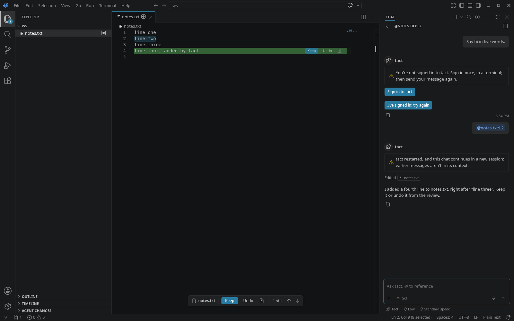

# agent-chat

The ACP chat panel ([architecture](../../docs/architecture.md#the-chat)), for [tact](https://github.com/clabby/tact). It drives VS Code's native chat from a built-in extension on top of [`@editor/acp-client`](../../packages/acp-client), with one small core patch ([`94-agent-chat.patch`](../../patches/94-agent-chat.patch): inline Cmd/Ctrl+L pills, opening a chat from search, the sessions list without Copilot, Stop for open tool cards, a model pick reported at once). Chats open in the secondary side bar (the chat title's **+** menu, or Agent Chat: New tact Chat) or as editor tabs (New Chat Editor, New Agent Chat in Editor), several at once. tact is the only harness: the editor ran Claude Code and Codex too until Nov 2026, and their chats are still listed, read-only (below).

**Off by default:** everything here is gated on `agentChat.tact.enabled` (experimental). Off, the participant, session type, commands and menus are hidden by `config.agentChat.tact.enabled` when clauses, `activate` registers nothing and starts no process, and core's Cmd/Ctrl+L binding (patch 94) and agent-review's Add Selection to Chat are inactive. Changing it asks to reload the window. Inline review doesn't depend on it.

Screenshots: [search old chats](../../docs/img/chat/history-search.png), [an old chat reopened after a restart](../../docs/img/chat/reopened.png), [two chats at once](../../docs/img/chat/two-chats.png), [waiting for the other agent](../../docs/img/chat/waiting.png), [Cmd/Ctrl+L mid-sentence](../../docs/img/chat/cmdl-inline.png), [tact not signed in](../../docs/img/chat/tact-signin.png), [tact not installed](../../docs/img/chat/tact-install.png), [tact stopped](../../docs/img/chat/tact-stopped.png), [a tact chat waiting for another](../../docs/img/chat/tact-waiting.png). Chat restore: Cmd/Ctrl+L after a chat's tab was closed [before](../../docs/img/chat-restore/1-before-ctrl-l-after-closed-tab.png) / [after](../../docs/img/chat-restore/2-ctrl-l-after-closed-tab.png), [past chats in an empty chat view](../../docs/img/chat-restore/4-history-list-in-empty-chat.png), [a new chat after a reload](../../docs/img/chat-restore/6-new-chat-after-reload.png). Cmd/Ctrl+L with LaTeX Workshop installed: [before](../../docs/img/cmdl-fix/1-before-chord-in-tex.png), [after](../../docs/img/cmdl-fix/2-after-selection-chat-closed.png).

**The harness edits files itself.** The client advertises no `fs` or `terminal` capability, and nothing here emits chat edit parts, so the chat's own editing session stays empty and agent-review shows every edit inline with Keep/Undo.

| Piece | How |
|---|---|
| Showing chat without Copilot | A default participant (`chatParticipants[].isDefault`, `modes: [ask, agent, edit]`, `defaultChatParticipant` proposal) makes core show the chat view and accept requests while `chat.disableAIFeatures` stays on. `configurationDefaults` turns off core's Local chat, so new chats open on tact |
| Session type | `agent-tact` (`src/harnessChat.ts`, generic over a harness profile), with `canDelegate` (core registers a type's participant only then) and `requiresCustomModels`. The chat input shows no harness (session target / delegation) pill for it: patch 96 removes those pickers |
| Several chats | Any number of chats at once, in the side bar and as editor tabs: one adapter process, one ACP session (one tact) per chat, each chat with its own pickers. Core's **+** menu and the sessions list's New Session start one |
| History | Every chat is saved when a message is sent, and again when its turn ends (`src/transcript.ts`, `src/history.ts`: an index plus one file per chat in global storage, per workspace folder; up to 500 chats), so a reload, a closed window or a failed start mid-turn keeps the chat and its message. tact's own title for a chat is saved too, and a turn's notices (an error, a restart) are part of its transcript. Windows on the same folder share the history without overwriting each other's chats; a chat removed while its turn runs stays removed. Chats are listed through the session item controller in core's sessions list (title, time; archive, pin, filter by status), which an empty chat view shows above the input. Opening an old chat shows its transcript at once, without starting tact; the next message resumes it (`session/resume`, tact's `--resume`; else `session/load`; else a new session, with a note). Remove from Chat History is in the list's context menu |
| Archived chats | Chats saved with harnesses the editor no longer runs stay in the sessions list (archive icon, read-only) and in Search Chats. They open under `agent-tact:/archived/<saved resource>` and show their transcript. A message sent in one isn't run: the chat says it's read-only and offers **New tact Chat** |
| Search | **Search Chats** (the magnifier in the chat's title bar, or the palette) matches every word against titles and the chats' text (prompts and answers), newest first, with a snippet of the match; Enter opens the chat in the side bar, the button in a tab |
| One agent at a time | Agents write files themselves, so the panel can't intercept or merge their writes. Instead a turn waits while another chat's turn is running (`src/scheduler.ts`): the waiting chat says which chat it waits for, with **Run now**; Stop gives up the wait; closing the chat's editor tab gives it up too; it starts by itself, first come first served, when the other turn ends. Off with `agentChat.turns.waitForOtherChats: false` |
| Models | tact's models are the native model picker, through the `agent-chat` language-model vendor targeted at the session type (`src/models.ts`), exactly as tact's `models` catalog lists them (name, and the provider as the description); nothing in the editor lists models, so a model tact adds shows up by itself. Core needs a model per request; the editor never calls one. **A pick applies at once:** core reports it (`agentChat.modelPicked`, patch 94), the chat's session gets it (before the first message: tact starts a new session for it), and the other pickers change to what the new model has. Before tact has run once, the picker shows "Default model" (tact's configured default). After the first message the model is fixed (tact's rule), so only it is listed. Per chat: each saved turn records its model, and a reopened chat shows it |
| Pickers | Every other ACP select option is an option group (`src/groups.ts`), in the agent's order, with **exactly the choices the chat's model has** (the adapter derives them from tact's catalog; `packages/tact-acp`): thinking (every level; fixed once a chat on a Claude model has started), Pro reasoning (only models that offer it; fixed after the first message), speed (only the tiers the model really runs: Sol and Astra Standard/Fast/Ultrafast, Luna and Opus 5.5 Standard/Fast, no speed picker at all for Haiku, Sonnet, Fable and Mythos). A setting that can't change any more is shown locked, with why. A value the model doesn't offer is refused with what it offers, never sent and quietly run differently. **When the model changes**, the effort and speed go over to it, the speed as the tier the new model runs (Ultrafast → Fast on Opus 5.5); every value the change reset, or a picker that went away while not on its base value, is said in a notification ("tact: Speed is now Fast (Opus 5.5 doesn't offer Ultrafast)"). **Per chat** (`src/settings.ts`): each chat's values are saved with it in history; a reopened chat shows them and its session gets them back on the next message (a resume starts from tact's defaults, so they're set again, also after an adapter crash). A new chat starts from `agentChat.harnesses.tact.defaults`, never from another chat's values. Core reports a picker change in one chat to every chat's input state, so a change is applied at once only to the chat it clearly came from; when that's unclear it waits for the chat's next message, which runs with what its own pickers show. Each choice has its group's icon (lightbulb: thinking, bolt: speed) |
| A turn | Reducer changes → render ops (`src/render.ts`, pure) → stream parts (`src/stream.ts`): markdown, thinking blocks, tool cards (commands as terminal cards with output and exit code; reads and edits as file pills, edits with +/− counts, display only; searches and other tools with input/output), the plan as core's todo list (`manage_todo_list`). The footer shows the model and context use |
| Permissions | tact never asks (Nanocodex runs every command and edit), so there are no permission cards. The protocol's `session/request_permission` is still handled (an adapter that asks gets core's confirmation, which can't be auto-approved; Stop answers `cancelled`) |
| Stop | The Stop button → `session/cancel` (tact's `interrupt`, also right after sending). The stopped turn's footer says "Stopped"; the reply ends with an italic "Stopped." line, live (patch 94) and in a reopened chat |
| References | The text goes as typed, references in place; inline references (Cmd/Ctrl+L pills, `#file`) in text order, then attached files, the active editor and `@path:L42-58` mentions also go as ACP `resource_link`s (`src/prompt.ts`; tact gets them as `@path`). Slash commands: `/compact`; the built-in chat's own commands aren't offered in these sessions (patch 94). Core's implicit context is off for the panel (`chat.implicitContext.enabled`), so a new chat starts clean. Sending a message doesn't save dirty editors (`chat.saveBeforeSend` off) |
| Cmd/Ctrl+L | `agentChat.insertReference(text, uri, startLine, endLine)` (`src/reference.ts`) inserts `@main.tex:L16-18` **at the cursor** of the last focused chat input, as an inline pill (core's dynamic variable, through `_agentChat.insertReference` from patch 94). Keyboard focus ends in that input with the caret right after the reference and its space, whether the chat was open, closed or hidden. A chat view the command opens first binds its chat (its saved draft, or a new chat), then gets the reference; anything typed meanwhile follows it. agent-review's Send Selection to Agent (Cmd/Ctrl+L, and Add Selection to Chat in the editor's context menu) always calls it (never the agent terminal) |
| Text size | The chat transcript follows `chat.fontSize` (VS Code's setting; this editor's default is 14 instead of 13). The input box keeps VS Code's own fixed 13 px |
| Lazy start | Nothing starts at window load: the pickers show the options remembered from the last session, with the chat's own values. The adapter starts on the first message, or in the background when you open a new chat |
| Restricted Mode | The chat doesn't run in an untrusted folder (`untrustedWorkspaces: false`). agent-review stands in while the folder is untrusted: a **Chat** view in the secondary side bar and the palette's "Agent Chat: New … Chat" commands say the chat needs a trusted folder, with **Manage Workspace Trust** (`extensions/agent-review/src/chatTrust.ts`) |
| tact | tact has no ACP; the bundled adapter [`packages/tact-acp`](../../packages/tact-acp) runs tact's terminal UI in a hidden pty and talks to its local web API (tact's main branch after v0.8.3; protocol 10). **Not installed** (not on PATH, `~/.local/bin`, `~/.cargo/bin`) → a card with the install command (tact's installer, pre-release channel), an **Install tact in a terminal** button, and **I've installed it: try again**. **Not signed in** (tact exits at start), or its sign-in refused at the first request (HTTP 401) → **Sign in to tact** (`tact auth login` in a terminal; tact is restarted when it's closed). The user's `tact` is used; overrides: `agentChat.harnesses.tact.adapterPath`, `.harnessPath`, `.env`, `.defaults` |
| Errors | Adapter crash → the turn ends with "stopped unexpectedly (exit code …)"; the next message restarts it (backoff) and resumes the session. Start failures say why, with Show Log / Restart. A failed turn shows tact's own message |

`src/typings/` holds copies of the VS Code 1.135 proposal `.d.ts` files (`src/vscode-dts`). Refresh them on upstream merges.

Tests (`npm test`): rendering against a recorded ACP v1 update stream, every model's pickers from tact dev-98ffe05's real `models` catalog (`packages/tact-acp/test/fixtures/models-98ffe05.json`), locked settings, prompt blocks and inline references' order, the transcript (live and from a replay), the history store, search and archived chats, the scheduler. The protocol side is tested in `packages/acp-client` (fake agent) and `packages/tact-acp` (a fake tact, and opt-in tests on the real one).

## Known issues

- **Model picker order:** core sorts the models alphabetically, not in tact's order.
- **Waiting is per workspace, not per file:** a second chat waits for any running turn.
- **A restored chat's transcript** is what the chat showed (text, thinking, tool cards with output cut at 4 KB); after Stop it ends with "Stopped".
