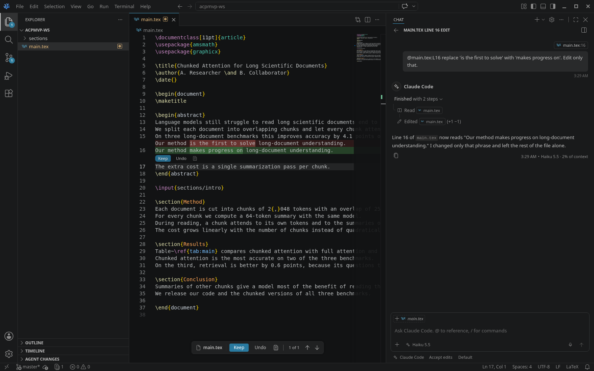
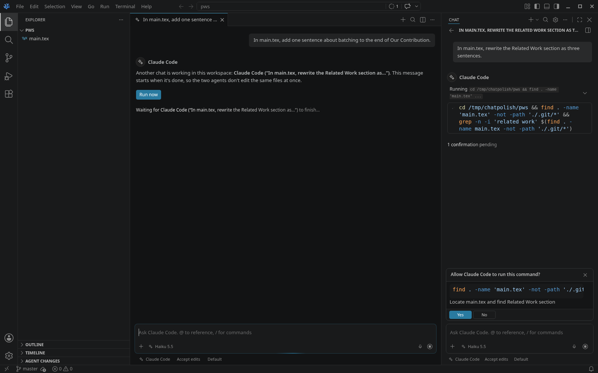

# agent-chat

The ACP chat panel ([PLAN.md](../../PLAN.md) §5.4 and Phase 4, design in [docs/acp-design.md](../../docs/acp-design.md)). It drives VS Code's native chat from a built-in extension on top of [`@editor/acp-client`](../../packages/acp-client), with one small core patch ([`94-agent-chat.patch`](../../patches/94-agent-chat.patch): inline Cmd/Ctrl+L pills, opening a chat from search, the sessions list without Copilot, Stop for open tool cards). Chats open in the secondary side bar (the chat title's **+** menu: New Claude Code / Codex / tact Session; or Agent Chat: New … Chat) or as editor tabs (New Chat Editor, New Agent Chat in Editor), several at once.

Chat polish (history, tabs, tact, waiting, inline references): [search old chats](../../docs/img/chat/history-search.png), [an old chat reopened after a restart](../../docs/img/chat/reopened.png), [two chats at once](../../docs/img/chat/two-chats.png), [waiting for the other agent](../../docs/img/chat/waiting.png), [Cmd/Ctrl+L mid-sentence](../../docs/img/chat/cmdl-inline.png), [tact's pickers](../../docs/img/chat/tact-pickers.png), [tact not signed in](../../docs/img/chat/tact-signin.png), [Stop with a command open](../../docs/img/chat/stop-skipped.png); from the dev build: [the sessions list](../../docs/img/chat/sessions-list-dev.png), [the + menu](../../docs/img/chat/new-chat-menu-dev.png).

MVP: [permission prompt](../../docs/img/acp/permission-prompt.png), [mode picker](../../docs/img/acp/mode-picker.png), [model picker](../../docs/img/acp/model-picker.png), [Cmd/Ctrl+L reference](../../docs/img/acp/cmdl-reference.png), [Codex not signed in](../../docs/img/acp/codex-signin-chat.png) ([picker](../../docs/img/acp/codex-signin-picker.png)), ["always" not shown as an agent edit](../../docs/img/acp/settings-local-ignored.png).

**The harness edits files itself.** The client advertises no `fs` or `terminal` capability, and nothing here emits chat edit parts, so the chat's own editing session stays empty and agent-review shows every edit inline with Keep/Undo.

| Piece | How |
|---|---|
| Showing chat without Copilot | A default participant (`chatParticipants[].isDefault`, `modes: [ask, agent, edit]`, `defaultChatParticipant` proposal) makes core show the chat view and accept requests while `chat.disableAIFeatures` stays on. `configurationDefaults` turns off core's Local chat, so new chats open on Claude Code |
| Session types | `agent-claude`, `agent-codex`, `agent-tact`: one per harness profile (`src/harnessChat.ts`), each with `canDelegate` (core registers a type's participant only then) and `requiresCustomModels` |
| Several chats | Any number of chats at once, in the side bar and as editor tabs, of any harness: one adapter process per harness, one ACP session per chat, each chat with its own pickers. Core's **+** menu (New Claude Code / Codex / tact Session, New Chat Editor) and the sessions list's New Session start one |
| History | Every chat's transcript is saved after each turn (`src/transcript.ts`, `src/history.ts`: an index plus one file per chat in global storage, per workspace folder; up to 500 chats) and listed through the session item controller in core's sessions list (title, time; archive, pin, filter by status), together with the agent's own sessions from `session/list` (Claude Code lists its terminal sessions too; untitled ones are skipped). Opening an old chat shows its transcript at once, without starting the agent; the next message resumes the ACP session (`session/resume`; else `session/load`; else a new session, with a note). A listed session we don't have is opened with `session/load`, its replay becoming the transcript. Remove from Chat History is in the list's context menu: the chat leaves the sessions list and Search Chats at once; the agent's own session is closed, not deleted, and remembered as removed so `session/list` doesn't bring it back |
| Search | **Search Chats** (the magnifier in the chat's title bar, or the palette) matches every word against titles and the chats' text (prompts and answers), newest first, with a snippet of the match; Enter opens the chat in the side bar, the button in a tab. Core's own list filter matches titles only |
| One agent at a time | Agents write files themselves, so the panel can't intercept or merge their writes. Instead a turn waits while another chat's turn is running (`src/scheduler.ts`): the waiting chat says which chat it waits for, with **Run now**; Stop gives up the wait (core keeps the waiting line after Stop, so the footer says "Stopped while waiting: not sent"); closing the chat's editor tab gives it up too (the message never runs; the reopened chat says it wasn't sent); it starts by itself, first come first served, when the other turn ends. Chats in plan or read-only mode don't wait. Off with `agentChat.turns.waitForOtherChats: false` |
| Models | The harness's `model` options are the native model picker, through the `agent-chat` language-model vendor targeted at the session type (`src/models.ts`). Core needs a model per request; the editor never calls one. A picker selection is applied when the user changed it, so the agent's own model switches stick. Per chat: each saved turn records the model it ran on, and the reopened chat's history gives it to core as the request's `modelId`, which core selects in that chat's picker (before, a reopened chat showed the type's default model, which was whichever chat last reported its options, so it was right or wrong depending on the chat used last before quitting); the session gets the chat's saved model back when it resumes. A "Default (recommended)" choice whose description is a model is shown by that model ("Opus 5.5 (default)"), and core renames the selected model when the real list replaces the placeholder (patch 94) |
| Pickers | Every other ACP select option is an option group (`src/groups.ts`), in the agent's order: Claude's mode (Plan is a mode, also `/plan`), effort and fast; Codex's approval preset, collaboration mode (`/plan`), effort and fast. Codex's next-turn options say "Applies from your next message". Re-rendered from every response and `config_option_update`. **Per chat** (`src/settings.ts`): each chat's values (mode, model, effort, fast) are saved with it in history; a reopened chat shows them and its session gets them back on the next message (a `session/resume` or `session/load` starts from the agent's defaults, so they're set again, also after an adapter crash). A new chat starts in the profile's default (Claude: Accept edits), never in another chat's mode. A permission mode that can't be set again (the agent refuses it, or no longer offers it) falls back to the strictest one offered (Claude: Manual), and the chat says so; if even that fails, the message isn't sent. Every message runs with what its chat's pickers show. Core reports a picker change in one chat to every chat's input state, so a change is applied at once only to the chat it clearly came from; when that's unclear it waits for the chat's next message, except a stricter mode for a running turn, and a looser mode is never applied on a guess. Chats saved before settings were kept reopen in the strictest mode. Selections made in an untitled chat carry over to its first message. Each choice has its group's icon (shield: mode, lightbulb: effort, bolt: fast; the footer shows the selected item's icon and name, the group's name is the tooltip). Dangerous values (Codex Full access) need a modal confirm; Claude's Bypass is removed from the session and hidden |
| A turn | Reducer changes → render ops (`src/render.ts`, pure) → stream parts (`src/stream.ts`): markdown, thinking blocks, tool cards (commands as terminal cards with output and exit code; reads and edits as file pills, edits with +/− counts, display only; searches and other tools with input/output), the plan as core's todo list (`manage_todo_list`). The footer shows the model and context use |
| Permissions | `session/request_permission` → core's `vscode_get_confirmation_with_options` (can't be auto-approved): the exact command or paths, the agent's description, buttons Yes / No / "always" (with where it's saved). Stop answers open prompts `cancelled`. Every decision is in the log |
| Stop | The Stop button → `session/cancel` |
| References | The text goes as typed, references in place; inline references (Cmd/Ctrl+L pills, `#file`) in text order, then attached files, the active editor and `@path:L42-58` mentions also go as ACP `resource_link`s (`src/prompt.ts`). Slash commands: Claude's and Codex's common ones are listed for completion (with `/plan` from the mode picker); the built-in chat's own commands (`/vscode-pet`, `/models`, `/debug`, `/clear`, ...) aren't offered in these sessions (patch 94); any other `/command` goes through as text. Core's implicit context (the active editor's file or selection as a chip, always attached) is off for the panel (`chat.implicitContext.enabled`), so a new chat starts clean; Cmd/Ctrl+L and `@` reference text. Sending a message doesn't save dirty editors (`chat.saveBeforeSend` off): unsaved edits stay the user's, and an agent write under them is a conflict to merge |
| Cmd/Ctrl+L | `agentChat.insertReference(text, uri, startLine, endLine)` inserts `@main.tex:L16-18` **at the cursor** of the last focused chat input, as an inline pill (core's dynamic variable, like `#selection`, through `_agentChat.insertReference` from patch 94), so a message can say "in this part @main.tex:L7-8, fold in this argument @main.tex:L13". Typing or pasting inside a pill turns it back into plain text, with every character kept; Backspace at a pill's end removes the whole pill. The sent message shows the pills in its text only, not again as file cards above it. agent-review's Send Selection to Agent always calls it (never the agent terminal) |
| Lazy start | Nothing starts at window load: the pickers show the options remembered from the last session, with the chat's own values (a new chat's: the profile's defaults). The adapter starts on the first message, or in the background when you open a new chat |
| tact | tact has no ACP; the bundled adapter [`packages/tact-acp`](../../packages/tact-acp) runs tact's terminal UI in a hidden pty and talks to its local web API (tact's main branch after v0.8.3). Pickers: model (until the first message), thinking, Pro reasoning, speed, and a fixed "Approvals: Never asks" (tact has no approval mode). Not signed in → the sign-in state (`tact auth login`); not installed → how to install it |
| Install | The user's `claude`/`codex`/`tact` on PATH is passed to the adapter. The pinned adapter is installed on first use into global storage (`npm ci` with the lockfiles in `dist/adapters/`, without the bundled harness binary when the CLI is on PATH) and runs under the editor's own Node. Overrides: `agentChat.harnesses.<id>.adapterPath`, `.harnessPath`, `.env`, `.defaults` |
| Errors | Not signed in → a "Not signed in" picker and an in-chat warning with **Sign in** (runs `claude auth login` / `codex login` in a terminal; the adapter restarts when it closes). Adapter crash → the turn ends with "stopped unexpectedly (exit code …)"; the next message restarts it (backoff) and resumes the session. Start failures say why, with Show Log / Restart |
| Workspace trust | Agents don't start in Restricted Mode |

`src/typings/` holds copies of the VS Code 1.135 proposal `.d.ts` files (`src/vscode-dts`). Refresh them on upstream merges.

Tests (`npm test`): rendering against a recorded Claude run, pickers from recorded config options, prompt blocks and inline references' order, the transcript (live and from a replay), the history store and search, the scheduler. The protocol side is tested in `packages/acp-client` (fake agent, contract tests) and `packages/tact-acp` (a fake tact).

## Known issues

- **Model picker order:** core sorts the harness's models alphabetically.
- **Waiting is per workspace, not per file:** the panel only learns which files a turn touches while it runs, so it can't promise two turns won't meet in one file; a second chat waits for any running turn. Plan and read-only chats never wait.
- **A restored chat's transcript** is what the chat showed (text, thinking, tool cards with output cut at 4 KB); after Stop it ends with "Stopped".
